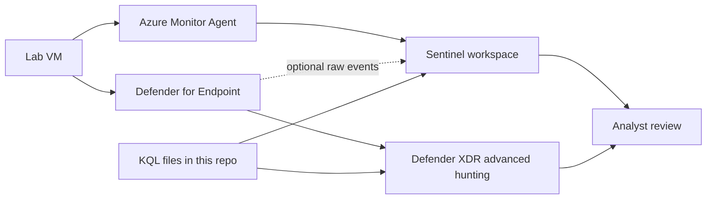

# KQL Detection Library

A lab library of Kusto Query Language (KQL) hunts for Microsoft Sentinel and Microsoft Defender XDR. The hunts are mapped to MITRE ATT&CK. You run them against your own lab tenant and your own lab VM.

Nothing in this repository is a tested detection yet. Every query is marked `untested`. The results tables are empty on purpose. Add screenshots, rows, and lessons only after you produce them. Do not invent a finding to fill a gap.

This repo does not build the Sentinel workspace. Use the workspace from [Sentinel-Home-SOC-Lab](https://github.com/Sasa021/Sentinel-Home-SOC-Lab). Do not create a second workspace for these queries.

## What this proves

When the lab is finished, the repo can show that you can:

- Write KQL against real Sentinel and Defender tables.
- Map a hunt to a current ATT&CK technique.
- Generate the matching activity on a lab VM you own, with Atomic Red Team or a small manual step.
- Say whether the query fired, and what would make it noisy.

It does not prove that the queries are production ready. A row in a lab is not an incident.

## Skills and tools

- KQL in Microsoft Sentinel Logs and in Defender XDR advanced hunting
- Windows Security auditing (`SecurityEvent` IDs such as 4625, 4720, 4732, and 1102)
- Defender tables (`DeviceProcessEvents`, `DeviceFileEvents`)
- Entra ID sign-in logs (`SigninLogs`), if the tenant can export them
- MITRE ATT&CK Enterprise
- Atomic Red Team and Invoke-AtomicRedTeam, on the lab VM only
- The Azure Monitor Agent collection you already set up in Sentinel-Home-SOC-Lab

Prefer free tiers. Read the cost section in [docs/lab-guide.md](docs/lab-guide.md) before you enable a connector. Ingestion can cost money after a trial ends. A daily cap is part of the lab, not an optional extra.

## ATT&CK techniques

ATT&CK v19 renumbered two techniques used here. Clear Windows Event Logs is **T1685.005** (previously T1070.001). Disable or Modify Tools is **T1685** (previously T1562.001). This repo uses the current IDs.

Some techniques sit in more than one tactic. The folder is the tactic used for the hunt. The query header names the technique ID.

| Technique | Name | Folder in this repo |
| --- | --- | --- |
| T1110.001 | Brute Force: Password Guessing | credential-access |
| T1110.003 | Brute Force: Password Spraying | credential-access |
| T1003.001 | OS Credential Dumping: LSASS Memory | credential-access |
| T1003.002 | OS Credential Dumping: Security Account Manager | credential-access |
| T1059.001 | Command and Scripting Interpreter: PowerShell | execution |
| T1105 | Ingress Tool Transfer | command-and-control |
| T1136.001 | Create Account: Local Account | persistence |
| T1098.007 | Account Manipulation: Additional Local or Domain Groups | persistence |
| T1053.005 | Scheduled Task | persistence |
| T1543.003 | Windows Service | persistence |
| T1547.001 | Registry Run Keys / Startup Folder | persistence |
| T1685.005 | Clear Windows Event Logs | defense-impairment |
| T1685 | Disable or Modify Tools | defense-impairment |
| T1082 | System Information Discovery | discovery |
| T1087.001 | Account Discovery: Local Account | discovery |
| T1057 | Process Discovery | discovery |
| T1049 | System Network Connections Discovery | discovery |
| T1021.001 | Remote Desktop Protocol | lateral-movement |
| T1074.001 | Local Data Staging | collection |

T1053.005 is also Execution and Privilege Escalation. T1098.007, T1543.003, and T1547.001 are also Privilege Escalation.

The full list of files, with blank test columns, is [detections-index.md](detections-index.md).

## Architecture

You do not need a new Azure resource for this repo. Queries read data the Sentinel lab already collects, plus Defender advanced hunting if the lab VM is onboarded.



The dotted line is optional. Streaming Defender raw events into Sentinel copies data you can already search in advanced hunting, and it can increase the ingestion bill. For this lab, run `DeviceProcessEvents` and `DeviceFileEvents` queries in the Defender portal.

`SecurityEvent` and `SigninLogs` use `TimeGenerated`. Defender device tables use `Timestamp`. That difference is expected.

## Repo structure

```
LICENSE
README.md
detections-index.md
.gitignore
detections/credential-access/
detections/execution/
detections/persistence/
detections/defense-impairment/
detections/discovery/
detections/lateral-movement/
detections/collection/
detections/command-and-control/
docs/lab-guide.md
docs/screenshot-checklist.md
docs/report-template.md
docs/atomic-red-team-testing.md
evidence/README.md
tools/validate-kql-headers.py
```

Each `.kql` file starts with a header:

```
// name:
// attack_technique:
// data_source:
// description:
// false_positives:
// tuning_notes:
// atomic_test:
// status:
```

`tuning_notes` must keep the word `PLACEHOLDER` until you replace the note with what you actually changed. `status` stays `untested` until you have run that query. Check the files with:

```bash
python3 tools/validate-kql-headers.py
```

On Windows you can use `py -3 tools\validate-kql-headers.py`.

## How to reproduce

Lab only. Your tenant, your VM, no employer data and no customer data.

1. Read [docs/lab-guide.md](docs/lab-guide.md) and set a daily cap before you hunt.
2. Confirm `SecurityEvent` is arriving in the Sentinel workspace from Sentinel-Home-SOC-Lab.
3. Onboard the lab VM to Defender only if you want the `Device*` queries. Use advanced hunting rather than a second copy of the data in Sentinel.
4. Follow [docs/atomic-red-team-testing.md](docs/atomic-red-team-testing.md). Run one test at a time on the lab VM, then run the cleanup for that test.
5. Save screenshots under `evidence/` using the names in [docs/screenshot-checklist.md](docs/screenshot-checklist.md). Redact IPs, tenant IDs, emails, and secrets.
6. Fill the Tested and Fired columns in [detections-index.md](detections-index.md) only for queries you ran.
7. Write the report from [docs/report-template.md](docs/report-template.md).

Planning time is in the lab guide. A first pass of the safe discovery hunts is an afternoon if the workspace already exists. Credential dumps and log clearing need a snapshot and a separate sitting.

## Results

PLACEHOLDER. Do not paste sample rows here until they come from your own lab run. For each query you test, record the date, the atomic test or the manual step, whether it fired, and the evidence file name.

| Query | Date tested | Fired (yes/no) | Evidence file |
| --- | --- | --- | --- |
| | | | |

## Lessons learned

PLACEHOLDER. Write this after the lab. Include what was noisy, what never fired, what you would change, and which tests you would not run again.

## About me

PLACEHOLDER. Replace this with your own summary before you treat the README as finished.

Mosa Mofokeng is a junior Cyber Security Analyst in Cape Town, South Africa. She holds ISC2 CC and Microsoft SC-200. She is building this lab herself.

- LinkedIn: add your LinkedIn profile URL here
- GitHub: [github.com/Sasa021](https://github.com/Sasa021)
